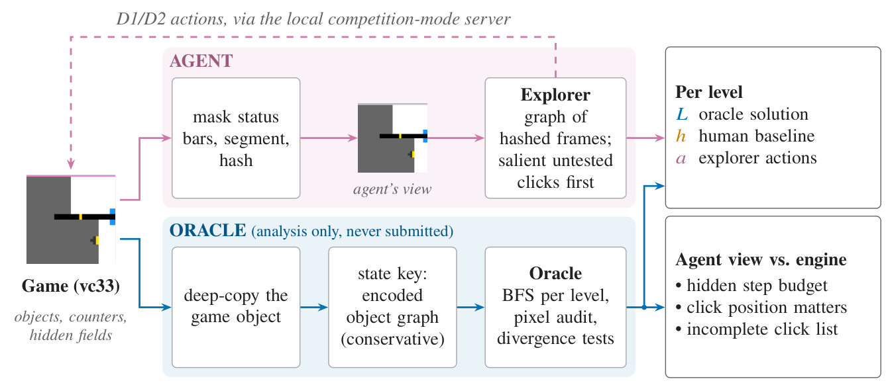
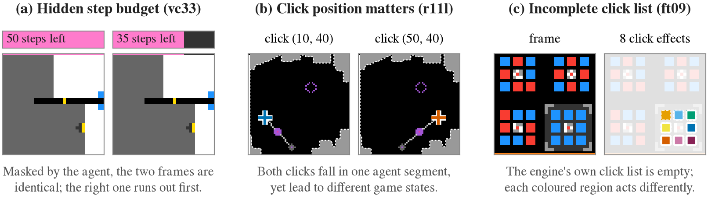
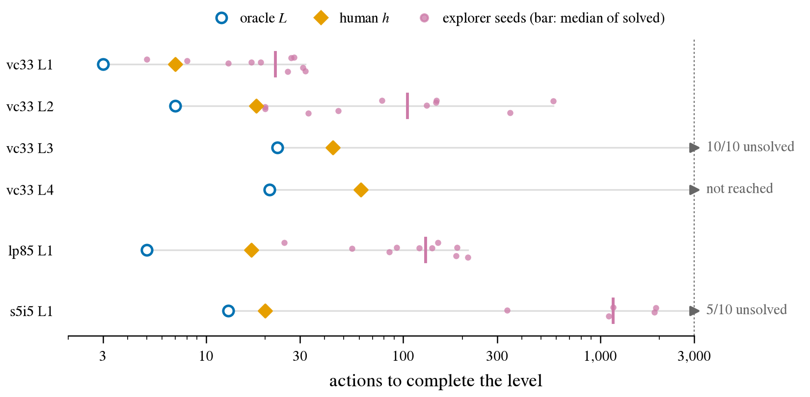

# Three Abstraction Gaps of a Graph Explorer on ARC-AGI-3

## Abstract

We audit an LLM-free graph explorer with engine copies, conservative state encodings, and click probes. The audit finds hidden budget information, position-dependent click outcomes, and incomplete engine click lists. We compare replayed solution lengths with human baselines and explorer action counts. A paired four-bucket budget intervention showed no solving gain; co-solved levels tended to cost more actions in post-hoc, exploratory analysis. None of these results establishes a gap's causal contribution to score. [docs/results-d3.md, docs/d3-plan.md]

## Introduction

A graph explorer treats each masked, hashed frame as a state and each candidate click as an action. On ARC-AGI-3, three abstraction gaps separate that picture from the game's dynamics. Masking hides budget information: in lp85, 15/15 sampled groups of identical masked frames later diverged. Coarse actions obscure position dependence: expanded r11l states average about 194 distinct click outcomes (engine list plus a 4-px grid). The engine's own click list is also incomplete, missing changes other than budget-only in 5/7 audited games. [docs/results-d1.md, docs/results-oracle-levels.md]

These gaps can mislead exploration. State aliasing can make deterministic transitions look inconsistent when distinct states share a graph node. Action aliasing can undermine tested-action markers when one label covers different click coordinates. D1 diagnoses the gaps, D2 compares explorer variants, and D3 tests a budget proxy. [docs/results-d3.md, docs/d3-plan.md]

ARC-AGI-3 scores a solved level by Relative Human Action Efficiency (RHAE), min(1.15, (*h*/*a*)²). Here *a* counts the agent's actions to solve the level and *h* is the upper-median count among first-time human completers. Game scores weight levels by level number and are capped by weighted completion. Public scores use a 0–100 scale. [Official methodology](https://docs.arcprize.org/methodology). [docs/related-notebooks.md] *L* is a solution length found and replayed by our analysis-only search oracle.

## Prior work

[Rudakov et al. (2025)](https://arxiv.org/abs/2512.24156) introduced the just-explore graph explorer that we port. Public [FORGE](https://www.kaggle.com/code/projectforty2/forge-arc-agi-3-agent) and [Hybrid Solver](https://www.kaggle.com/code/vyankteshdwivedi/arc-agi-3-hybrid-solver-bfs-cnn-heuristics) notebooks search cloned engines, and Hybrid Solver also falls back to a pixel grid. [Franzen's harness](https://www.kaggle.com/code/dfranzen/arc-agi-3-milestone-2-solution) warns that ignoring the HUD can hide countdowns. [skarin](https://www.kaggle.com/code/skarin/arc-agi-3-27-80-lb-100-trajectory-audit) compares per-level human and agent actions. We add an empirical audit of this explorer and replayed solution references.

Our 2026-10-22 survey records self-reported LLM-harness notebook scores around 21–32, a leading leaderboard score of 68.91 (method unverified), and LLM-free scores below 1 among those surveyed, all on the 0–100 scale. [docs/related-notebooks.md]

## Approach

Our port of the explorer masks status bars, hashes frames, records tested state–action pairs, and routes to nearby untested actions. The seg-groups condition clicks connected segments ordered by five salience-priority groups. The px-flat condition uses pixel candidates without these groups, and px-groups adds the ordering back.

All D1–D3 agent experiments ran against a localhost server in competition mode, whose per-level action counts matched a remote spot check on vc33. [runs/2026-10-21_remote_spotcheck.jsonl] RESET counting differs between local NORMAL and competition modes: 75 versus 79 actions on ls20. [runs/2026-10-21_compare_modes_ls20.jsonl]

To measure the gaps we built an analysis-only oracle (Figure 1). It deep-copies the game object and keys states by a conservative, typed, reference-numbered encoding. The encoding excludes bookkeeping, other-level templates, and rendering caches, and it does not encode RNG internals or array-sharing relations. Level-start audits click all 4,096 pixels. Per-level solution searches also omit budget fields. lf52 keys change under copying, so oracle conclusions exclude that game. Copy fidelity and merged-state successors were only spot-checked and the budget omission is unverified, so a replayed solution is valid but not proven minimal. [docs/results-d1.md §3, docs/results-oracle-levels.md]

D1, D2 and D3 each had pre-registered criteria. D1 was halted and amended. [docs/d1-plan.md, docs/d2-plan.md] [docs/results-d1.md] [docs/d3-plan.md]

*Figure 1. Agent execution (D1–D3) and the analysis-only oracle, which is never submitted. Encodings and copies are checked by sampling.*

## Results

Our [Kaggle code submission](https://www.kaggle.com/code/b05204047elias/arc2026-horizons-arc-agi-3-explorer), submission **57458354**, scored **0.19**, versus random **0.09**, on the public **0–100 scale**, separately from D1/D2. [docs/submissions.md]

### State aliasing: hidden budget

In lp85, all 15 sampled groups of identical masked frames diverged under later shared actions. The difference checker reported only counters and display fields. In vc33, pre-constructed budget pairs diverged in 1/20 continuations for 50 versus 45 steps remaining and in 0/20 for 50 versus 35. The checker can miss differences. The vc33 rates describe constructed pairs, without measuring how often play reaches them. [runs/2026-10-21_oracle-probe.jsonl, runs/2026-10-21_budget-alias.jsonl]

### Action aliasing: click position

In r11l, an expanded state has about 194 distinct click outcomes on average (engine list plus a 4-pixel grid). Across D1 seeds, seg-groups logged 67 outcome_flip events (one state–action pair both changing and not changing the frame) and 1 same-point conflict (differing outcomes at one state and pixel), while px-flat logged 0 of each. [docs/results-d1.md] In the existing D2 r11l runs, px-flat and seg-groups both solved 1.0 levels on average. Across ten seeds, same-point conflicts totaled 7 for seg-groups and 1 for px-flat, while px-groups solved 0 levels with 64 conflicts. [docs/results-d3.md]

Logs and probes agree qualitatively, but changed visitation and retesting confound attribution to within-segment position and any solving benefit from fewer conflicts. [docs/results-d1.md]

### Candidate coverage: incomplete click lists

At level-one starts, clicks outside the engine's list produced changes other than budget-only in 5/7 games with copy-stable keys, or 6/7 when budget-only effects count. lf52 was excluded. In ft09, the list is empty, yet clicks have 8 distinct effects. [runs/2026-10-22_oracle-audit-starts.jsonl, runs/2026-10-22_oracle-levels.jsonl] Agents using listed or visually inferred candidates may miss effects; these different candidate sets require separate audits.

*Figure 2. Engine-derived illustrations: (a) vc33 budget masking, with author-annotated step counts, (b) r11l click position, (c) ft09 click effects. Panel (a) does not itself show divergence, and panel (b) shows one pair, not the cause of aggregate log conflicts.*

### Oracle, human, and explorer action counts

To put efficiency in context, *a* is the median among successful seeds from ten D2 seg-groups runs. [docs/results-oracle-levels.md, runs/2026-10-22_d2-seg-groups.jsonl]

| Level | L | h | a (solved-seed median) |
|---|---|---|---|
| vc33 1 | 3 | 7 | 22.5 |
| vc33 2 | 7 | 18 | 105 |
| vc33 3 | 23 | 44 | 10/10 unsolved |
| vc33 4 | 21 | 61 | not reached |
| lp85 1 | 5 | 17 | 130.5 |
| s5i5 1 | 13 | 20 | 1,163 (5/10 solved) |

*L* upper-bounds the shortest solution within the oracle's action set. Across levels, *h/L* lower-bounds human actions relative to that optimum at 1.5–3.4×. On solved levels, the explorer takes 3.21–58.15× the human baseline (*a/h*) and 7.5–89.46× the found solution (*a/L*). These comparisons do not attribute the excess actions to particular gaps.

*Figure 3. Replayed oracle solutions, human baselines, and explorer seeds. Bars mark solved-seed medians; unsolved and unreached levels are marked separately.*

### Cost of the hidden budget (D3)

D3 tests whether exposing a budget proxy helps. It added a four-bucket visual budget proxy (b4) to the seg-groups state key on eight games × ten seeds, paired with the D2 baseline at 3,000 actions per run. The pre-registered primary difference in solved levels (b4−baseline) was −0.025 (95% confidence interval [−0.150, +0.088]). The mechanism difference in conflicts per 1,000 actions was +20.5 (95% CI [−2.7, +45.5]). Both are inconclusive. [docs/results-d3.md, docs/d3-plan.md]

Every run used 3,000 actions, so pre-registered mean-action comparisons are degenerate when reached-level sets match. A **post-hoc, exploratory** comparison paired game/seed/level records solved under both conditions: 12 used fewer actions with b4, 32 more, and 7 tied. Median actions rose for vc33 levels 1 and 2 (22.5→32.5 and 105→147.5), lp85 level 1 (130.5→190.5), and r11l level 1 (30.5→36), but fell for ft09 level 1 (1142→661). Across the four games with ≥5 pairs, the mean of per-game medians of paired log(b4/baseline) action ratios was 0.2645 (95% CI [0.0938, 0.4488]) (10,000 whole-game bootstrap draws, default_rng(0)). [docs/results-d3.md]

The extra actions are consistent with finer state keys splitting the graph and reducing reuse, but this neither proves that mechanism nor measures the total cost of aliasing. Joint-success selection, four eligible games, floor effects, reused D1 games, changed revisit opportunities, an uncalibrated proxy with within-bucket aliasing, and a historical baseline limit interpretation. [docs/results-d3.md, docs/d3-plan.md]

### Limitations

Salience ordering roughly doubled segment click hit rates (fraction of clicks changing the frame) in 2 of 3 D1 development games, lp85 and vc33. [docs/results-d1.md] In D2, ordering lowered segment hit rates in 4/8 games, most in lf52 (−0.123), then r11l (−0.102). D2 confirmatory ordering tests were inconclusive. [docs/results-d2.md]

Coverage is limited to eight public click games and early oracle levels. Rarely solved held-out games create a floor effect. Held-out seg-groups logs contain 844, 505, and 1,759 conflicts in lf52, s5i5, and su15. These repeated observations rely on obfuscated field differences and establish neither independent defects nor causes. [docs/results-d2.md]

## Conclusion

The three abstraction gaps are measurable. Exposing a coarse budget proxy showed no solving gain in this sample and an exploratory action-cost increase on co-solved levels. Future tests should weigh state detail against graph reuse, alongside finer click representations and candidate coverage, and report actions beside *h* and *L*. [docs/results-d3.md, docs/d3-plan.md]
